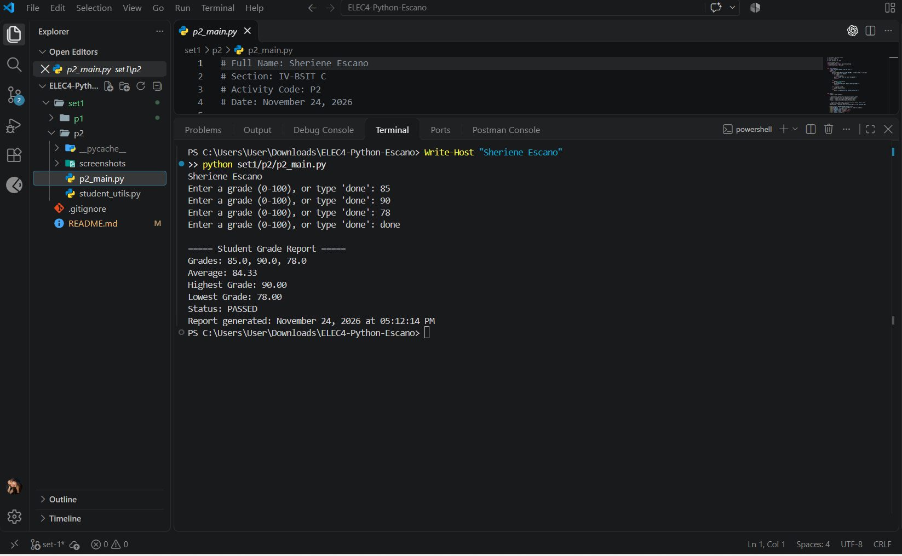

# ELEC4-Python-Escano

- **Full Name:** Sheriene Escano
- **Section:** IV-BSIT C
- **Course:** ELEC 4 - Python Programming

## Activities

| Activity | Description | Folder |
|---|---|---|
| P1 - Student Grade Calculator | Menu-driven functions for grade averages and results | [set1/p1](set1/p1) |
| P2 - Custom Student Module | Reusable grade utilities and built-in module usage | [set1/p2](set1/p2) |

## How to Run

```powershell
python set1/p1/p1_grade_calculator.py
python set1/p2/p2_main.py
```

## P1 Run Summary

The sample run uses grades 85 and 90. The average is 87.50, the highest
grade is 90.00, the lowest grade is 85.00, and the status is PASSED.


## P2 Run Summary

P2 uses the custom `student_utils` module and the built-in `datetime` module.
It validates entered grades and displays the average, highest grade, lowest grade,
and pass/fail status together with the report generation date and time.


